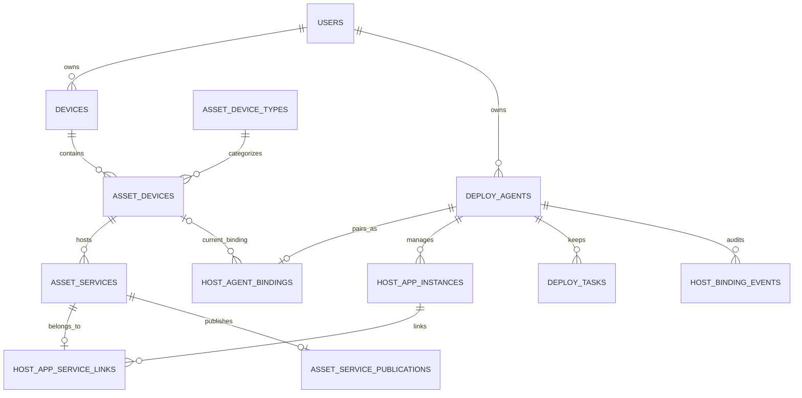

# T00-04 — EasyTier / EasyHostAgent 持久化、主机归属与设备删除设计

> 审查日期：2026-10-27  
> 状态：**DONE（技术模型与拟议 DDL 交付；未执行生产数据库迁移或修改业务代码）**  
> 前序：[`T00-01-easytier-audit.md`](./T00-01-easytier-audit.md)、[`docs/api/contract-v1.md`](./api/contract-v1.md)  
> SQLite 拟议结构：[`docs/schema/T00-04-proposed.sql`](./schema/T00-04-proposed.sql) — **不是可直接套用的线上迁移脚本**。正式迁移须在 EasyTier `easytier-web/src/migrator/` 编写并验证。

## 一、现有事实和需要解决的冲突

以 EasyTier `feat/automation-center` 中读取的真实代码为准：

1. `devices` 为 **EasyTier 网络节点**，复合主键 `(user_id, machine_id)`（机器 ID UUID）。
2. `asset_devices` 为 **网络节点下的资产设备**，唯一标识 `(id, owner_user_id, machine_id)`。其 `device_type_id` 关联 `asset_device_types`，后者 `semantic_kinds` 是 JSON 数组，含 `server` 时才算服务器设备。二者不可混称为相同的 device_id。
3. `asset_services` 是资产设备下的 EasyTier 服务，外键 `(device_id, owner_user_id, machine_id)` → `asset_devices` **ON DELETE CASCADE**；`asset_service_publications` 负责服务公网映射。
4. `asset_devices` 对网络节点 `devices` 采用 **ON DELETE RESTRICT**；`CentralNetworkService::delete_device` / `Db::delete_device_with_optional_block` 在存在资产时已显式拒绝删除网络节点。
5. `AssetsStore::delete_device` 在删除资产设备时，会触发 `asset_services` 的级联删除。这与“删除 EasyTier 设备时仅解绑 Agent，保留服务”冲突。
6. `deploy_agents` 现有独立连接行以 `id` 为 PK、`user_id` 为所有者，包含 `credential` 密文、`agent_id`、快照；`deploy_tasks.connection_id` → `deploy_agents.id` 使用 **ON DELETE CASCADE**，因此删除 Agent 行会同时毁掉历史任务。
7. 已有用户软删除机制（`users.deleted_at`）：账号停用不删除该用户的资产和网络节点，因此可以沿用用户原归属，不需要设备转移。

**决定**：保留 `deploy_agents` 作为稳定的**宿主机记录**，额外创建一对一的 `host_agent_bindings` 描述当前绑定；应用实例和任务直接归属稳定宿主机；保留服务依靠资产设备逻辑归档（tombstone），而不是直接删除有服务的资产行。没有第二套用户/设备台账。

## 二、身份字典

| 标识 | 数据来源 | 作用域和稳定性 | 是否可以替代其他标识 |
|---|---|---|---|
| `owner_user_id` | EasyTier `users.id` | 宿主机归属不可转移；admin 可管理所有 | 不可以 |
| `machine_id` | EasyTier `devices.machine_id` | 仅对应 EasyTier 网络节点，必须与 owner 组成复合键 | 不等于资产设备 |
| `asset_device_id` | EasyTier `asset_devices.id` | 已选中 `server` 语义的物理/逻辑服务器资产 | **API PairingRequest.device_id 就是此值** |
| `agent_id` | EasyHostAgent 首次安装生成 | Host 上稳定 UUID；卸载重装导致新 ID 时必须重新配对 | 不等于 IP 或 EasyTier machine_id |
| `host_connection_id` | 现有 `deploy_agents.id` | EasyTier 中长期保持的宿主机记录主键；**解绑后保留** | 不能拿它当 Agent ID |
| `app_id` | Deploy `app.yaml.id` | 应用模板稳定 slug（如 portainer、sub2api） | 与已安装实例 ID 不同 |
| `app_instance_id` | `host_app_instances.id` | 一次被管理的逻辑应用实体；一宿主机同 app_id 只有一个记录 | 不等于 Compose project / container |
| `service_id` | `asset_services.id` | EasyTier 服务，可能在安装前就已手工创建；一个服务只能归一个受管应用 | 不等于 app instance |
| `task_id` | 用户操作时 EasyTier 生成 UUID | 同一 Agent 下幂等执行键，查询结果不可重新生成 | 不等于应用实例 |
| `catalog_revision` | EasyTier 中心 Deploy Git commit | 商店定义版本，不是 Agent 下载版本 | 不等于 deployment bundle SHA |
| `bundle_sha256` | 按固定 commit 生成的包 | 固定安装文件内容；部署后需保留 | 不等于业务 image digest |

业务中的“主机”=现有 EasyTier 资产设备绑定的宿主机控制能力。**真实 Host 持久记录 ID 是 deploy_agents.id，绑定可以改变或解除，原应用/任务不会因此消失。**

## 三、数据关系图



网络节点的复合所有权键、资产设备的所有权键和服务范围键在所有新业务中继续保留。

## 四、SQLite 持久化方案

### 4.1 复用和扩展已有表

**`deploy_agents`**（现有）：作为稳定 Host 主记录继续使用 `id`、`user_id`、`agent_id`、密文 `credential`、身份/发现快照、更新时刻。增加复合唯一索引 `(id,user_id)`，供新外键明确租户边界。

**`deploy_tasks`**（现有）：继续保留 `connection_id`、`task_id`、`request_cipher`、`result_json`、`logs` 和 `log_offset`；无论 Agent 解绑与否，任务历史不删除；长任务真值由 Agent 本地 SQLite 负责，EasyTier 是快照/用户操作历史。

**`asset_devices.archived_at`**（拟议新增）：当前服务器资产删除时，如果存在受管应用/服务/绑定等依赖，标记逻辑归档、隐藏于普通设备列表，**不物理删除**，从而保留原服务和公网映射归属。新建同 IP 资产若与归档资产唯一约束冲突，明确提示“需先恢复/处理归档资产”，**不自动接管或覆盖**。

**`devices.inventory_archived_at`**（拟议新增）：现有网络节点删除有资产依赖时不执行硬删除，标记不再显示为活跃节点，但保留网络节点 DB 主键及历史资产/服务所需外键。网络会话与受管网络配置的停止/退网由现有中心网络服务协调完成；不能通过普通 heartbeat/登录自动取消归档标记。服务展示需标记源节点已归档或不可达。

> 两个“归档”字段并不意味着以后所有设备删除都软删：**有引用就归档；无引用可继续走现有安全硬删流程。** 先解绑/失效控制授权再归档、确保事务一致性。实际行为需要 T01-05/T01-06 与原删除路径一起改造。

### 4.2 新建表

| 表 | 主键/唯一约束 | 保存内容 | 删除约束 |
|---|---|---|---|
| **`host_agent_bindings`** | PK `connection_id`；`agent_id` 全状态唯一；活跃资产设备唯一 | 当前所绑定 `owner_user_id, machine_id, asset_device_id`、Agent ID、TLS 指纹、代数、状态、旧设备快照 | FK 指向现有 deploy_agents 与 asset_devices；解绑置 `unbound` 并清空当前设备外键，不删除宿主机主记录 |
| **`host_app_instances`** | PK `id`；UNIQUE `(host_connection_id, app_id)` | 固定 app_id、Compose project、安装源、包版本、加密配置、安装时根目录、状态、上次观察时间 | 宿主机 FK `ON DELETE RESTRICT`，不直接引用可删的资产设备 |
| **`host_app_service_links`** | PK `(instance_id,service_id)`；UNIQUE `service_id`；每实例唯一 `is_primary=1` | 应用 ↔ 服务的明确归属（包含手工关联服务）、服务设备范围、同步状态 | 删除服务可连带移除链接；删除有链接的应用实例会被 FK 拒绝，必须先完成服务清理 |
| **`host_binding_events`** | PK `id` | 配对、解绑、重配、失败撤销等身份事件，操作人及时间 | 只记元数据；**绝不记录 Token、配对码或明文密码** |

不建立独立 `hosts` 平行实体。中央商店缓存/索引属于 M3，Agent 本地任务表属于 M4，均不在本项重复建立。

### 4.3 几个关键约束

- `host_agent_bindings.agent_id` **全状态唯一**，而非“仅已绑定唯一”：同一 Agent 重配必须找回同一个 `deploy_agents.id`；不允许一个物理 Agent 被不同用户重复认领，符合“不支持设备转移”。
- `host_app_instances(host_connection_id,app_id)` 全生命周期唯一；更新/重装/失败恢复复用同一条管理记录，不能绕开旧失败现场再创建第二个受管实例。
- `host_app_service_links.service_id` 全局唯一；因此卸载一个应用不会误删除另一个应用共用的服务。一个实例可有多个服务，仅一个主要入口。
- 每次管理请求按 `host → deploy_agents.user_id → host_agent_bindings → asset_device` 校验 owner 和资源归属；admin 允许跨 owner 管理，但写入记录仍使用目标 owner，绝不能将资源“转入管理员名下”。
- `config_cipher` 加密保存配置中的敏感内容，绑定 token 在现有 `deploy_agents.credential` 密文保存，Agent 本地配置和日志另行防护。不以 JSON 明文列保存 secret。
- `unbound` 时 EasyTier 抹除旧 `credential` 的实际密文（`credential` 旧列为 NOT NULL，可用空串哨兵并严格在业务中拒绝）；保留任务密文和已保存的应用配置。
- 对 legacy `deploy_agents` 的旧 Token / 手工 endpoint 不视为已完成新一次性配对：需要明确“尚未验证”兼容状态及人工迁移/重新授权入口，不能自动赋予新高权限。

## 五、设备语义识别与权限

### 5.1 服务器设备选择

以 `asset_device_types.semantic_kinds` JSON 数组判断服务器语义：

```sql
SELECT d.id AS asset_device_id, d.owner_user_id, d.machine_id
FROM asset_devices AS d
JOIN asset_device_types AS t
  ON t.id = d.device_type_id AND t.owner_user_id = d.owner_user_id
JOIN devices AS n
  ON n.user_id = d.owner_user_id AND n.machine_id = d.machine_id
WHERE d.archived_at IS NULL
  AND n.inventory_archived_at IS NULL
  AND EXISTS (
    SELECT 1 FROM json_each(t.semantic_kinds) AS kind
    WHERE kind.value = 'server'
  );
```

不能只查老字段 `semantic_kind='server'`：旧字段不一定含 server，新数据以 `semantic_kinds` 为准。变更设备类型移除 `server` 时，已有 Agent 绑定需先明确解除，不能导致一个已配对主机静默不可管理。

### 5.2 角色范围（复用已有 admins/owner）

- 普通用户仅访问其 `owner_user_id = session.user.id` 的现有资产设备、绑定、应用、任务和服务。
- admin 可在保持**原 owner 不变**的情况下访问全部用户的已登记设备；针对停用账号的资源仍保留，但操作时应遵守现有 `users.deleted_at` 限制。
- 不支持设备转移、宿主机跨用户转移；若 `agent_id` 曾在另一个 owner 的 Host 主记录出现，不允许用新的用户简单抢占绑定。
- 前端传入 `owner_user_id` 不构成授权；Rust 服务器端复用 `assets::authorize` 语义并校验实体的 `(owner, machine, asset_device)` 关系。
- Agent 验证的是配对控制端、设备 ID、权限令牌和允许的操作，不直接信任浏览器发送的用户角色。

## 六、生命周期和删除行为：精确顺序

### 6.1 正常配对 / 重新配对

1. 从已归属的活跃资产设备校验 `semantic_kinds` 含 `server`。
2. 发起按需 HTTPS 身份探测，校验本地可信的 TLS 公钥指纹和 `agent_id`；完成一次性配对。
3. 在数据库事务中以 `agent_id` **查找并复用**稳定宿主机记录；若 owner 不同则拒绝跨用户转移；同 owner 已绑定其他设备时拒绝重复绑定。
4. 更新当前 `host_agent_bindings`，令 `binding_generation += 1`，写入新的 Agent 凭证密文，旧 Bearer 不再使用。
5. 保留 `host_app_instances` 和 `deploy_tasks`；原先手工关联的服务仍保留在原服务 ID 上。
6. 若配对外部动作已成功但中心 DB 持久化失败：尽力撤销新令牌并展示异常；不得假设本地 SQLite 事务可以回滚已经执行的远端 HTTP 操作。

### 6.2 主动解除 Agent 绑定

1. 在中心端权限通过后，用事务阻断后续 Agent 操作，解绑当前资产设备引用；记录原设备、操作者和时间。
2. 保留同一条 `deploy_agents` 主记录、`host_app_instances`、`deploy_tasks` 及关联服务。
3. 清空旧 Bearer 密文，使 EasyTier 不可能继续拿它调用 Agent；Agent 在线时请求 `DELETE /v1/pairings/current` 并记录是否远端确认撤销。
4. **Agent 离线不能承诺“远端 Token 已立即删除”**：仅能保证 EasyTier 本地失效；不排离线命令。后续需主机本地管理员撤销旧令牌，或通过可信的重新配对轮换令牌。
5. 对于历史已绑定服务，展示状态为“来源主机解绑/不可确认”，不静默重绑其他 IP 或新资产设备。

### 6.3 删除服务器资产设备 `asset_devices`

- 如果该资产设备存在服务、绑定或其他引用：首先执行 6.2 的解绑，随后设置 `asset_devices.archived_at`；**不执行现有物理删除 SQL**。服务和公网映射原记录仍在，原关联设备/端口快照保留，服务展示状态标记原设备已归档。
- 如果没有任何保留引用：可以在完成授权清理之后使用现有硬删除流程。
- 如果未来复用该 IP 新建资产冲突：不能自动覆盖历史设备记录，应提示恢复归档资产或手动解决重复；**恢复归档不等于恢复 Agent 授权**，后者仍需新码重配。
- 公网映射保护：保留其数据库归属记录，但**不能自动把旧映射目标切到新主机或新 IP**。实际外部访问可能中断；若历史目的 IP 被其他设备复用，安全界面必须标出“陈旧目标/需确认”，后续同步动作须要求显式核对。是否需要暂停实际监听由网络安全实施阶段验证，不能臆称现有 publication 组件天然支持“暂停”。

### 6.4 删除 EasyTier 网络节点 `devices`

- 原 `CentralNetworkService::delete_device` 会拒绝仍有子资产的节点；新增方案必须沿同一共享 mutation lock 按依赖分支处理。
- 含资产、服务或公网发布依赖时：**逻辑退网/归档** `devices.inventory_archived_at`，不硬删节点主键。已有网络配置退出和会话断开仍需协调现有网络控制逻辑；禁止因为 HTTP 请求成功就假定所有运行时转发都已经撤销。
- 归档节点不会因下一次旧连接心跳自动“恢复”；注册/连接路径需要对归档态做屏蔽，恢复必须明确由用户操作。
- 资产/服务及原宿主机历史数据依旧存在；普通网络节点列表隐藏或展示归档标识，服务目录保持可查，但不得误报服务在线。
- 当节点没有任何资产与保留依赖时，可按现有安全删除路径处理。

### 6.5 卸载应用与外部 Docker 确认删除

1. Agent 执行卸载或完整 Docker inventory 确认资源不存在。
2. 仅当确认**任务完成**或 `inventory.complete=true` 且 `status=ok`、资源稳定标识确实缺失时，才进入 EasyTier 服务清理步骤；离线/异常响应不能删除服务。
3. EasyTier 查询 `host_app_service_links` 的**全部** `service_id`，调用现有资产服务删除逻辑；其内部负责精确移除自有公网映射，后续执行 runtime apply。
4. 所有对应服务及其专属映射同步后，解除关联链接，再按业务将应用状态设为 `uninstalled` 或在外部删除场景下真正删除应用管理记录。
5. 若某一步服务清理失败：保留主 AppInstance 的可见“联动待重试”状态，**不自动回滚已删除的其他服务**；重新执行时应幂等，只处理仍存活的链接。外部删除不得直接 DELETE AppInstance 绕开 RESTRICT 外键。
6. 正常卸载默认保留数据；彻底删除需额外二次确认和清晰数据边界。失败不回滚 Docker 现场。

### 6.6 Agent 自升级/主机重启

- 重启导致执行中任务 `interrupted`（UI 呈现失败），日志留存；不自动重试，也不执行自动回滚。
- Agent 升级在任务执行中禁止；自身升级失败只记错误且由用户手动修复，不为此建立快照回滚基础设施。
- Agent 不因主机 IP 变化创建新 host_connection；通过 `agent_id`、TLS 指纹和当前配对绑定来判断身份。

## 七、迁移阶段必须遵循的工程规则

1. **不得修改已执行过的 SeaORM 迁移文件**；后续在 `easytier-web/src/migrator/` 追加新迁移，按实际目标分支的迁移版本顺序命名，确保多分支有交叉时不会重名。
2. 迁移前备份原 `et.db` 和与凭证相关的 `.deploy-agent.key`；SQLite `PRAGMA foreign_keys=ON` 且 `PRAGMA foreign_key_check` 通过。
3. 先增加归档列与关联表/索引，再部署兼容读写逻辑，最后才启用新设备删除/解绑 API；**不能先开放会丢服务的删除路径**。
4. legacy `deploy_agents` 原来可能有重复 `agent_id`、独立手填 URL/Token：迁移前列出并做去重/人工确认；不能把旧记录无条件提升为已安全配对状态。
5. `deploy_agents.credential` 为 NOT NULL，解绑写**空字符串哨兵并立刻禁止请求**，不能只删除 UI 记录还留可调用 Token。
6. 新 `host_app_service_links` 应用服务匹配不能通过“同端口即归属”对历史数据自动生成；只有已明确安装并用户确认关联才写链接。
7. 原 `deploy_tasks` 依靠 `connection_id`；**禁止在解绑时删除 deploy_agents**，否则旧任务被现有 ON DELETE CASCADE 清掉。
8. SQLite 可以回滚未提交的**本地事务**以保证一致性，这不属于产品已经取消的“应用安装/升级自动回滚”，二者不能混为一谈。
9. 后端按 `owner_user_id` 过滤数据；admin 操作时复用真实 owner，严禁跨租户绑定服务；用于服务的 composite FK 需要准确匹配现有 UNIQUE 键。
10. `host_app_instances` 软状态及唯一索引会阻止安装重复实例；确认外部删除后必须先删除服务链接/服务并完成可观察的收尾，再删除应用管理主记录。

## 八、后续功能开发的验收用例

| ID | 用例 | 预期 |
|---|---|---|
| DB-01 | 普通用户查询其他 owner 的主机 | 后端拒绝，绝不靠前端隐藏 |
| DB-02 | admin 管理其他 owner 的主机 | 允许，但 owner 不变 |
| DB-03 | `semantic_kinds=['openwrt','server']` | 识别为服务器，可绑定 Agent |
| DB-04 | 仅老字段 `semantic_kind='other'`，JSON 不含 server | 不可绑定 |
| DB-05 | 同一 Agent ID 重复绑定两台资产设备 | 阻止，保留第一处授权 |
| DB-06 | 同一 Agent ID 被另一个用户重新认领 | 阻止，不支持所有权转移 |
| DB-07 | Agent IP 修改但 UUID、TLS 信任未变 | 同一主机记录，任务和实例不重复 |
| DB-08 | 解绑在线 Agent | 中心凭证清空，Agent 返回撤销确认，任务和应用历史保留 |
| DB-09 | 解绑离线 Agent | 中心停止授权、展示远端未确认，绝不称远端立即失效 |
| DB-10 | 删除有服务的资产设备 | 归档资产设备，服务/公网映射记录不被级联删除 |
| DB-11 | 删除有资产的网络节点 | 归档节点并协调退网，不因 FK 冲突强删 |
| DB-12 | 新建与归档资产重复的 IP | 拒绝并提示恢复/处理历史资产，不静默合并 |
| DB-13 | 同一主机同 app_id 重复安装 | 只允许一条受管实例，不能借失败状态重复创建 |
| DB-14 | 两个应用同时绑定同一个服务 ID | UNIQUE 限制拒绝 |
| DB-15 | 同一个应用多个关联服务 | 可以，只有一个主要服务 |
| DB-16 | 手工删除已关联服务 | 服务删除成功后关联关系自动失效，应用实例仍在 |
| DB-17 | Agent 离线/Docker 查询失败 | 保留原实例和服务，不触发外部删除 |
| DB-18 | 完整查询确认外部应用删除 | 按链接依次清理关联服务及专属映射，再清理应用管理记录 |
| DB-19 | 服务或公网同步部分失败 | 留可见错误与重试入口，不隐式回滚 |
| DB-20 | 宿主机重启任务中断 | 中断记录仍可查询，日志留存，不自动重启任务 |
| DB-21 | 解绑前后历史任务分页和日志 | 稳定可读；不会因外键级联消失 |
| DB-22 | 归档设备再次被旧 Agent 或旧节点自动上报 | 不自动恢复 UI/绑定 |
| DB-23 | 用户账号软删除 | 历史资产/Agent/应用仍属原 owner，旧用户不能登录使用 |
| DB-24 | 重新配对同一 Agent 且同 owner | 复用稳定 host_connection，旧 Bearer 不再使用，应用与任务不丢 |

以上用例是**后续迁移与业务集成必须执行的验收清单，不是假装本次已跑完**。

## 九、需要移交给后续任务的改造位置

| 任务 | 对应代码/设计工作 |
|---|---|
| **T00-05** | 根据 DB-01～DB-24 设计 FK/租户/归档测试和 mock fixture |
| **T01-05/T01-06** | `restful/assets/mod.rs`、`db/assets/devices.rs`、`central_network/service.rs`、`db/devices.rs`：主机入口/绑定/删除时逻辑归档及安全拦截 |
| **T01-06** | `easytier-web/src/deploy_agent.rs`、`restful/deploy_agent.rs`：保留主机记录、弃用硬删 Agent 接口、加实际设备 FK 和一次性配对 |
| **T02-06** | 外部 Docker 删除采用完整快照门槛 |
| **T04-01** | Agent SQLite 真值、现有 controller `deploy_tasks` 历史及查询兼容 |
| **T04-07/T05-05/T05-06** | `db/assets/services.rs`、`db/assets/publications.rs`、`restful/assets/publication_apply.rs`：应用服务明确关联、端口同步、卸载所有已链接服务 |
| **T06-03/T06-05** | 真实 owner/admin 隔离和归档/解绑失败的端到端验收 |

## 十、T00-04 验收结果

- [x] 对照真实 EasyTier 的网络节点、资产设备、服务、Agent、任务和用户软删除表，查清数据依赖。
- [x] 明确十类主键/ID 的来源、含义与权限边界，解决 Agent ID、网络节点 ID、资产设备 ID 混用风险。
- [x] 选择**复用 `deploy_agents` 主记录 + `host_agent_bindings` 当前绑定**，无重复宿主机台账。
- [x] 设计应用实例与多服务显式关联、唯一索引、保存任务历史、部分失败状态。
- [x] 将删除有依赖的资产设备、网络节点定义为**业务逻辑归档**，避免服务被 cascade 或 FK 拒绝。
- [x] 添加拟议 SQLite DDL（归档列、关系表、唯一索引、阻止级联误删的 trigger），并描述正式迁移前置条件。
- [ ] 未在真实 ET 数据库上执行迁移；未构建 Rust；未做 FnOS 端到端。正式迁移、代码改造和集成测试属于后续任务。

**结论：T00-04 数据模型设计完成。下一项：T00-05 — 契约与数据库最小测试样本。**
